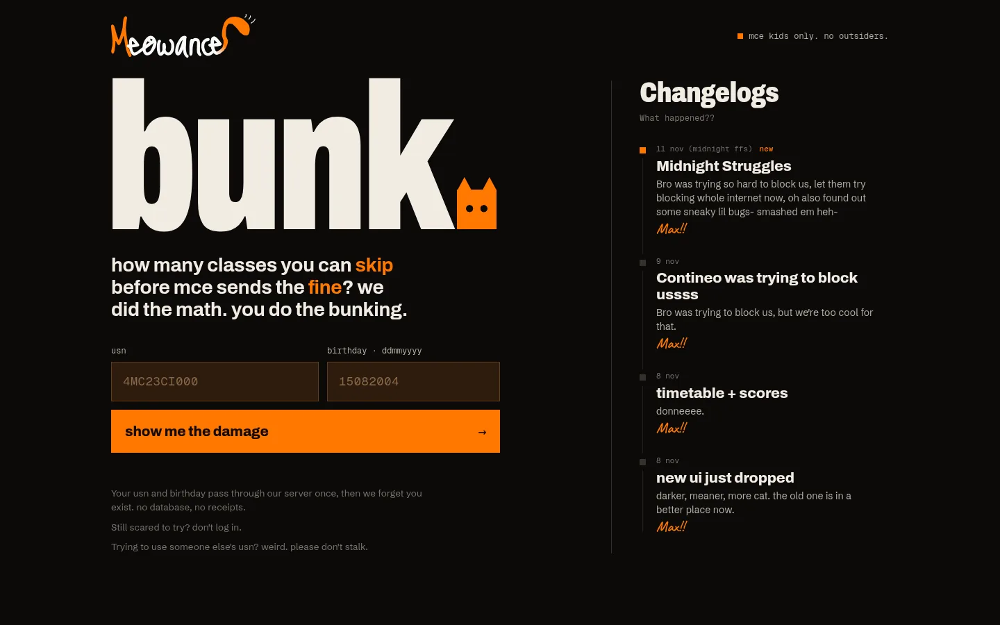
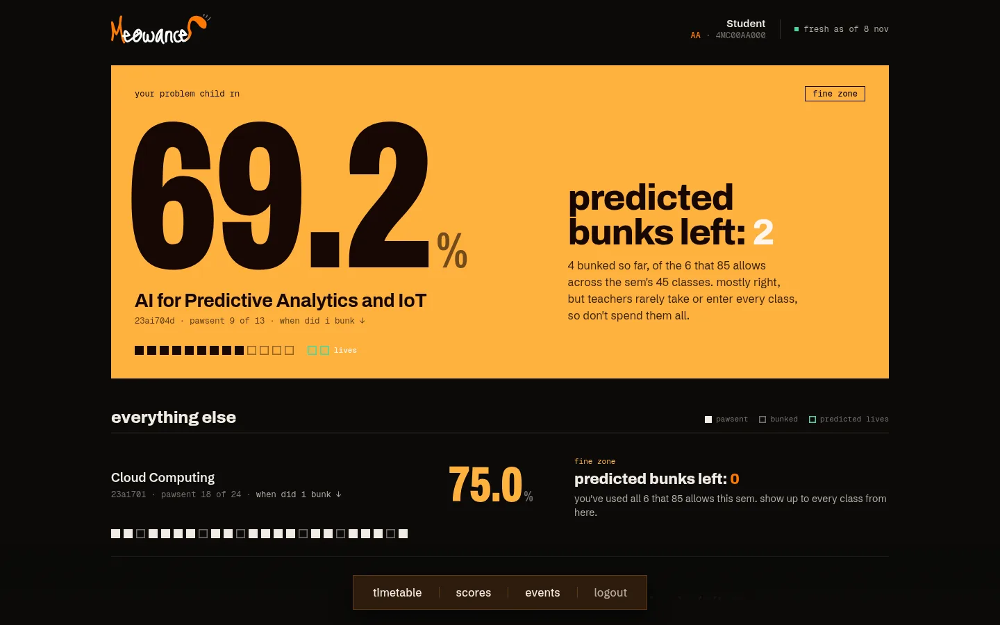
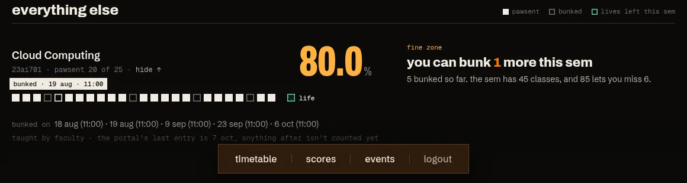
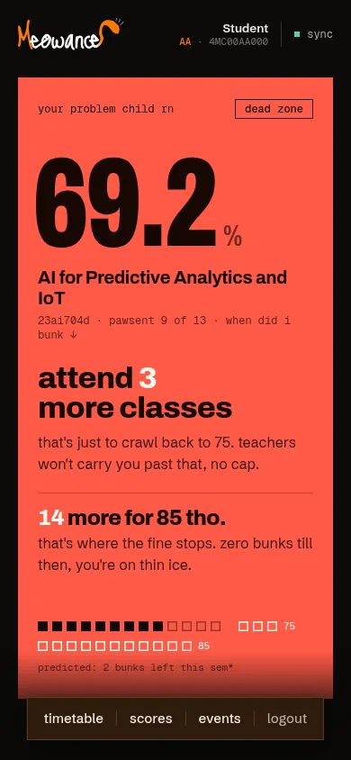
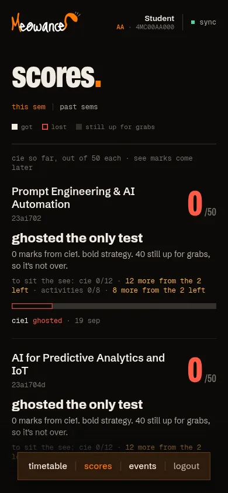
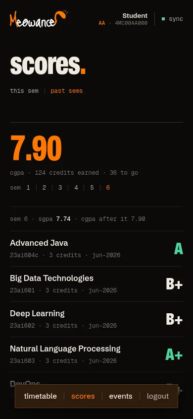

# meowance

meow + attendance. Log in with your MCE USN and birthday and meowance reads your attendance from the
college's Contineo portal, then tells you how many classes you can still bunk this sem before the
fine kicks in (85%) or you're cooked (75%).

Not affiliated with MCE. Nothing is stored on the server: your USN and birthday go to the portal
once, the answer comes back, and that's it.




Tap a course to see when you bunked (hover a box on desktop):



| dashboard | timetable | scores | past sems |
| --- | --- | --- | --- |
|  |  |  |  |

The screenshots use the mock data in `pkg/portal/testdata`: every name, number, date and grade
in it is invented. It is nobody's real record.

## What it shows

- **Dashboard:** every course's attendance, worst first. Each class is a box in real order:
  filled = pawsent, hollow = bunked, green = predicted bunks left. The verdict comes from the
  sem's total classes ("predicted bunks left: 1"), so it stays sane even when the portal is weeks
  behind on entering classes. It's a prediction: teachers rarely take or enter every planned
  class, so it's mostly right, not a promise.
- **Timetable:** this week, one day at a time, each class tagged by whether that subject can afford a bunk.
- **Scores:** this sem's CIE marks and the minimum to sit the SEE; past sems' grades, SGPA and CGPA.
- **Events:** the semester calendar: what's next, working days left.

Pages other than the dashboard are fetched only when you open them, and cached in your browser
until they change (the timetable for a week, the calendar for 7 days, a course's history until
its counts change).

## Stack

- **API:** Go, standard library only (`pkg/portal` logs in and parses the portal, `pkg/api` is the
  HTTP handler, `pkg/attend` the bunk math). Runs as a Vercel Go function.
- **Web:** Vite, React 19, Tailwind v4 (`web/`).

## Run it locally

You need Go 1.27+ and a recent Node (it's developed on Node 26).

```bash
cd web && npm ci && cd ..
```

### With the mocks (no portal, no login needed)

```bash
go run ./cmd/devserver -fixture pkg/portal/testdata/dashboard.html   # API on :8787
cd web && npm run dev                                                 # site on http://localhost:5180
```

- Log in with any MCE-shaped USN (`4MC00AA000`) and any real birthday (`15082004`).
- Birthday `01012000` is the "wrong birthday" case: you get the portal's rejection.
- The fixtures hold one saved page of each kind (dashboard, timetable, calendar, one course's
  class-by-class attendance, exam history). That one course page is served for every course you
  open, so every course shows the same sem total.

### Against the real portal

```bash
go run ./cmd/devserver
cd web && npm run dev
```

Log in with your own USN and birthday. The portal blocks datacenter IPs, so this works from home
but not from a cloud machine unless `OXYLABS_USERNAME` / `OXYLABS_PASSWORD` are set (a residential
proxy). The portal also goes down most nights, roughly midnight to 6am IST.

### Two at once

Change the ports to run a mock copy next to a real one:

```bash
go run ./cmd/devserver -fixture pkg/portal/testdata/dashboard.html -addr 127.0.0.1:8788
cd web && MEOWANCE_API=http://127.0.0.1:8788 npx vite --port 5182 --strictPort
```

`go run` doesn't reload: restart the API after Go changes. If a stopped `go run` leaves its
`devserver` behind, find it with `ss -ltnp` and kill that pid.

## Tests

```bash
go vet ./... && go test -race ./...     # parsers against the fixtures, a fake portal and proxy, the API
cd web && npm test                      # verdicts, the cache, dates, scores
cd web && npm run typecheck && npm run build
```

`go run ./cmd/demo pkg/portal/testdata/dashboard.html` prints the bunk table for a saved dashboard.

## Test data

Everything in `pkg/portal/testdata` is mock data: the page layouts come from the real portal, but
the student (`STUDENT`, USN `4MC00AA000`), lecturers (`FACULTY`), attendance counts and dates, CIE
marks, exam dates and grades are all invented, and every photo is the generic avatar. The weekly
timetable and the semester calendar are real class-level schedules (no student's record). Never commit
real student data or HAR files (`*.har` is git-ignored).

## Deploy

Live at https://meowance.vercel.app. Deploys go out from the Vercel CLI only (`vercel deploy` for
a preview, `vercel deploy --prod` for production); pushes don't deploy.
